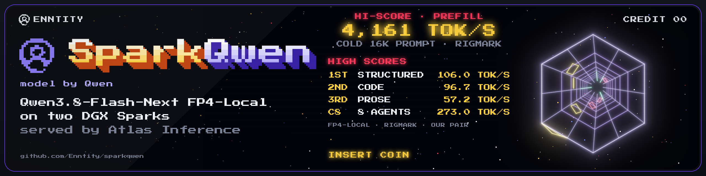

<p align="center">
  
</p>

# SparkQwen

**SparkQwen 0.1.0** · [Versioning](docs/VERSIONING.md). Run `./start.sh --version`
for this checkout, or `./start.sh status` for the version and image IDs on both ranks.

Qwen3.8-Flash-Next on two NVIDIA DGX Sparks, served by the
[Atlas](https://github.com/Enntity/atlas) inference engine: tensor and expert
parallelism across both boxes over one ConnectX-7 cable, NVIDIA's
[FP4-Local](https://huggingface.co/nvidia/Qwen3.8-Flash-Next-FP4-Local)
checkpoint loaded as published, the model's own MTP head for speculative
decoding, prefix caching, and an OpenAI-compatible API. It is the sibling of
[SparkGLM](https://github.com/Enntity/sparkglm), whose engine work, serving
policy and measurement rules it applies to Qwen's hybrid MoE (Gated DeltaNet
and sparse-indexed attention, 512 experts, PLE n-gram embedding).

```sh
git clone https://github.com/Enntity/sparkqwen.git
cd sparkqwen
cp .env.example .env      # set WORKER to the other Spark's ssh destination
./start.sh
```

**Status: maintenance publication accepted with known limitations.** The current source pin is
`63bebfa6` (tree `fa4e4817`), built as install tree `70890529ba64` through the
checked-in image build. It includes shared-expert TP and fixes for returned
speculative scores and accepted-token usage. The image's build and selected
final-image checks passed, but the full quality gate remains failed. Public source and
image verification and local repository checks passed. See the [candidate review](results/2026-10-20-fidelity-review/RESULT.md)
for exact identities, unedited receipts and the scoped publication disposition.

The default checkpoint remains
[`nvidia/Qwen3.8-Flash-Next-FP4-Local`](https://huggingface.co/nvidia/Qwen3.8-Flash-Next-FP4-Local),
pinned in [`install/checkpoint.json`](install/checkpoint.json). The exact engine
commit and tree were fetched anonymously after publication of source tag
`sparkqwen/fidelity-rc-20261019`. The tested image is available as
`ghcr.io/enntity/atlas-sparkqwen:70890529ba64`, verified by anonymous digest pull
at `sha256:a0cebe89737898692964d3923477bef293a4ebde9dd32e27202697c54f763c9d`. Earlier drafter and vision release measurements remain in
[2026-10-16-drafter](results/2026-10-16-drafter/RESULT.md) and
[2026-10-17-vision](results/2026-10-17-vision/RESULT.md).

## Current evidence

- Eight same-image serial/speculative prompts matched decoded reasoning,
  content, finish reasons and counts. Two biased completion cases matched all
  15 finite returned scores exactly. These checks do not establish generated
  token-ID identity or universal speculative exactness.
- Tool calling passed 21/21 cases. An automatic tool-or-JSON request nevertheless
  chose an unrelated stock-price tool instead of the requested Oslo JSON.
  Changing only `tool_choice` to `"none"` returned the expected JSON. Use that
  explicit choice when tool calls must be excluded.
- The two-hop needle test scored 59/60, with one wrong retrieval at 163,290
  prompt tokens; the retained shipped-history result was 60/60. Complete old
  request bodies are unavailable. The bounded C1 serial/speculative replay matched decoded outputs;
  it does not reproduce the original C4/cache conditions or prove general
  long-context exactness.
- On 27,034 identical prompt IDs, all 27,033 scored positions reproduce the
  earlier corrected shared-A4 candidate exactly. Candidate NLL is
  1.0659923317 versus 1.0255496918 for the observed A4 reference: an unresolved
  +0.0404426399 nats/token gap. The reference uses MXFP8 LM-head weights and
  FP8 KV; it is not a full BF16 oracle.
- Five- and eight-image cases passed. A tall-rectangle case exposed a wrong
  expected label in the grader. The original failed result is preserved.
  A corrected oversized-header probe returned HTTP 400
  `vision_input_too_large`; its earlier malformed-PNG decoder error is retained
  separately.

The completed main comparison has mixed results: cold 16K prefill rose from
4,140.743 to 4,451.413 tok/s (two observations per arm), while median code
decode fell from 113.503 to 106.988 tok/s (three per arm). C2/C4/C8 Rig aggregate
rates also fell. Matrix completed ten streams with matched request hashes: four aggregate
decode cells increased and C1-32K decreased, with one invocation per cell. The
[full main comparison](results/2026-10-20-fidelity-review/RESULT.md#matched-performance)
retains all repetitions and the four warm-conversation request differences. Historical measurements describe their
recorded engine, checkpoint and profile, and do not qualify this candidate.
See [LIMITATIONS](docs/LIMITATIONS.md) for the known failures and scope.

### Choosing a checkpoint

FP4-Local is the default because it is 28 GiB smaller, 10–14% faster at
one-stream decode and 4% faster at 16K prefill than the NVFP4 checkpoint on
the same engine and day (the eight-agent aggregate is level; see the
[results](results/2026-10-16-fp4local/RESULT.md#measurements)), and by
NVIDIA's evaluation within 0.7 points of BF16. Its license is
the NVIDIA Open Model Agreement (the NVFP4 release uses the NVIDIA Open Model
License); read it before you download ([docs/LICENSING.md](docs/LICENSING.md)).
To serve the NVFP4 checkpoint instead, set both lines in `.env` (the image
stays the same):

```sh
CHECKPOINT_REPO=nvidia/Qwen3.8-Flash-Next-NVFP4
CHECKPOINT_REVISION=fc694b54fb0174e0913e6adf86691ef85a4ead47
```

Historical shared-engine results include NVFP4 loading and prompt-logprob
checks. This candidate has not been requalified with NVFP4; the `FP8_GDN`
opt-in applies to that checkpoint only.

## Requirements

- Two DGX Spark (GB10, 128 GB) systems joined by a direct ConnectX-7 cable,
  with an IPv4 address on the cable's interface on each (RoCE; the engine
  finds the GID itself and uses both PCIe halves of the port).
- Docker with the NVIDIA runtime on both, and passwordless `ssh` from the
  Spark you run `./start.sh` on to the other one, whose user can run `docker`.
- About 140 GB free on each Spark: the checkpoint (95 GiB) is downloaded
  once and copied to the other Spark over the cable, and each Spark keeps a
  31 GB packed copy of its PLE n-gram table in `~/.cache/atlas-ple`, written
  on the first start (about a minute).
- The default 0.88 allocation expects the pair to serve Qwen alone. To leave
  room for other services, use the [0.70 sidecar example](.env.sidecars.example)
  and size those services against the available host memory.

## What `./start.sh` does

Run it on the Spark that will serve the API (rank 0). Each step is skipped when
already done, so rerunning it just restarts the engine.

1. **Image.** Pulls `ghcr.io/enntity/atlas-sparkqwen:<tag>`, where the tag is
   the git tree of [`install/`](install/) (the current candidate tree `70890529ba64`),
   so the image always matches your checkout. If that tag is not published
   (an edited `install/`, or `PULL=0` in `.env`), it builds the image from
   source instead ([`install/build.sh`](install/build.sh): Atlas at the commit
   and tree pinned in [`install/atlas-source.json`](install/atlas-source.json),
   for the `qwen3.8-flash-next` kernel target; 30–60 minutes cold). It then
   pulls or copies the image to the other Spark.
2. **Weights.** Downloads
   [`nvidia/Qwen3.8-Flash-Next-FP4-Local`](https://huggingface.co/nvidia/Qwen3.8-Flash-Next-FP4-Local)
   at the revision pinned in [`install/checkpoint.json`](install/checkpoint.json)
   (or the checkpoint `.env` names) and copies it to the other Spark. It uses
   `hf` when installed and a throwaway container otherwise. Nothing is
   converted; the engine decodes the checkpoint's compressed block scales and
   packs its PLE table into the per-node cache when it first loads.
3. **Serve.** Starts rank 1 over ssh, then rank 0, waits for health, then
   answers one smoke-test question.

Other commands: `./start.sh stop | status | logs [worker] | build | download`.

## Use it

The API listens on rank 0's loopback, `http://127.0.0.1:8893/v1`, model
`qwen3.8-flash-next-atlas`, with no authentication. Put your own
authenticated proxy in front of it before exposing it.

```sh
curl -s http://127.0.0.1:8893/v1/chat/completions -H 'Content-Type: application/json' -d '{
  "model": "qwen3.8-flash-next-atlas", "max_tokens": 512,
  "messages": [{"role": "user", "content": "Write a haiku about two small computers."}]}'
```

Streaming is supported. When `reasoning_effort` is omitted, the checkpoint
template selects `xhigh`. Set `low` or `medium` per request in
`chat_template_kwargs` when desired. The profiles impose no separate thinking
budget; the request's completion-token limit still applies. Requests that leave
sampling unset use the checkpoint's generation settings in every mode,
including requests with tools: temperature 1.0, top-p 0.95, top-k 20. Presence
and frequency penalties default to 0, repetition penalty to 1, and min-p and
top-n-sigma filtering are off. Explicit request values override these defaults.
Tool calls (OpenAI `tools`, streaming included) are parsed in the checkpoint's
XML call format (Atlas's `qwen3_coder` parser). The candidate uses the
checkpoint's tool template without extra tool-result hints, tool-call logit
steering, or a separate cap on prose between tool calls. The final-image tool cases passed 21/21; the automatic tool-or-JSON case
failed semantically. Set `tool_choice: "none"` when the request must return JSON
without a tool call; the exact control passed. See the
[candidate review](results/2026-10-20-fidelity-review/RESULT.md). With the NVFP4 checkpoint,
images pass the race, conversation,
swap and cached-versus-cold checks in
[results/2026-10-15-shared-engine](results/2026-10-15-shared-engine/RESULT.md);
on FP4-Local (MXFP8 attention, NVFP4 MLP, loaded exactly) the race,
conversation and swap checks pass, and a request may carry up to eight 2048x2048 images or 32,768 vision
tokens ([results/2026-10-17-vision](results/2026-10-17-vision/RESULT.md)).
Larger requests get an HTTP 400 `vision_input_too_large`; when the server's
in-flight image budget (65,536 vision tokens) is full, an HTTP 503
`vision_capacity_busy` with `Retry-After: 2`. Both limits are server flags
(`--vision-max-request-rows`, `--vision-max-inflight-rows`). The tested strict JSON-only case passed; automatic tool-or-JSON selection
can still choose an unrelated tool. Video has not been tested.

**Profiles** (`PROFILE` in `.env`):

- `8x32k` (default): up to eight requests of up to 32K context each, from one
  shared BF16 KV pool. Capacity is resolved at load from available memory;
  older releases reported about 3.42M tokens at `GPU_MEMORY_UTILIZATION=0.88`.
- `4x262k`: up to four requests of up to 256K context each, from the same
  pool (not yet measured with FP4-Local; 3.35M tokens with NVFP4).
- `8x262k`: up to eight requests of up to 256K context each, from the same
  pool. Older releases reported about 3.35M tokens; consult the current load log.

Each profile sets a concurrency limit and a per-request context limit. All
requests and the prefix cache draw on one shared pool; requests that together
need more tokens than the pool holds wait for room.

**Sharing the Sparks with sidecars.** To run the engine beside other services,
use the copyable [`.env.sidecars.example`](.env.sidecars.example): the measured
arrangement is `8x262k` at `GPU_MEMORY_UTILIZATION=0.70` on **both** ranks
(a mismatched share mis-sizes the one shared KV pool). At 0.70 the measured
pair held 1,351,648 shared KV tokens on the limiting rank (~1.35M) with the
NVFP4 checkpoint; FP4-Local's smaller weights should leave more, but 0.70 has
not been remeasured with it. 0.72 is an estimate only and has not been
qualified. What fits is host-dependent. The
sidecars are separate installations; `./start.sh` does not install them
([docs/LIMITATIONS.md](docs/LIMITATIONS.md), Running beside sidecars).

The candidate comparison uses explicit greedy settings for measurement. For real work leave sampling
unset (the defaults above) or use the model card's values; greedy decoding can
loop ([docs/LIMITATIONS.md](docs/LIMITATIONS.md), Behavior).

## Opt-ins

One, off by default. Add it to `.env` and rerun `./start.sh`; set 0 or delete
the line to roll back.

```sh
FP8_GDN=1    # NVFP4 checkpoint only: FP8 Gated DeltaNet projections, lossy
```

`FP8_GDN=1` made one-stream decode 1-12% faster on the NVFP4 checkpoint,
depending on the prompt, and scored 40/40 and 12/12 on our quality probe with
the 2026-10-06 engine, but its outputs differ from the default, and it has not
been measured with RC15 or later. FP4-Local already decodes those layers from
its own MXFP8 weights, so the engine refuses the switch with that checkpoint.

`QSA_TC2R` is gone: the tensor-core QSA prefill it selected became the
two-Spark default in RC15, and a leftover `QSA_TC2R=1` in `.env` is ignored.

## Reproduce our numbers

The benchmark drivers are in [`bench/`](bench/) ([bench/README.md](bench/README.md)).
See [docs/REPRODUCE.md](docs/REPRODUCE.md) for the exact commands.

## Other ways to run it

**By hand:** every step of `./start.sh` as a separate command, in
[docs/INSTALL-MANUAL.md](docs/INSTALL-MANUAL.md).

## The engine

Atlas here is [`Enntity/atlas`](https://github.com/Enntity/atlas) at the
commit pinned in [`install/atlas-source.json`](install/atlas-source.json),
built from four layers ([docs/ENGINE.md](docs/ENGINE.md)):

1. Atlas-Inf `main` base at `7ffd183f`.
2. SparkGLM's upstream GLM-5.3-Flash series, which carries the
   model-independent serving and pair-communication work; its GLM-only paths
   stay off for this model.
3. The Qwen3.8-Flash-Next series, which we intend to propose to Atlas-Inf
   after review: two-Spark tensor and expert parallelism for `qwen4_exp`, MTP
   at two Sparks, decode graphs, exact verify, batching and prefill kernels,
   and a few fixes picked from Atlas-Inf branches not yet on its `main`.
4. SparkQwen-only commits: exact batched speculation and exact prefix
   caching, tensor-core MoE and mHC decode, prefill MoE without a weight
   duplicate, multi-prompt prefill, long-context QSA decode and faster verify
   and prefill kernels, each behind a switch the profiles set. Since this
   release they include the FP4-Local series: a lossless decoder for the
   checkpoint's compressed NVFP4 block scales, MXFP8 decode straight from the
   checkpoint's bytes, W8A8 MXFP8 prefill through cuBLASLt (in-order kernels
   only, so prefill stays row-invariant and prefix caching stays exact), the
   NVFP4 PLE table read through a checksummed packed copy, and native NVFP4
   MTP experts. The series turns on by itself when the checkpoint is
   FP4-Local; the NVFP4 path is unchanged. The drafter series then gives the
   MTP drafter the target's own rows for the prompt and every verified token,
   a BF16 drafter router and a faster depth decision, and queues a long
   prompt's first prefill chunk behind the prefills in flight.

## Credits

Measurement: the decode-bench protocol of
[sparkDash](https://github.com/MiaAI-Lab/sparkDash) by MiaAI-Lab (MIT), whose
prompts `bench/sd_bench.mjs` imports from your own checkout;
[RigMark](https://github.com/alexellis/rigmark) by Alex Ellis (MIT); and
MiaAI-Lab's dual-Spark vLLM recipe, whose settings the vLLM baseline in our
earlier results ([2026-10-08-rc15](results/2026-10-08-rc15/RESULT.md)) uses.
The engine's Flash-Next fixes from Atlas-Inf name their origin commits in
[docs/ENGINE.md](docs/ENGINE.md).

## License

AGPL-3.0-only ([LICENSE](LICENSE)); third-party components keep their own
licenses ([NOTICE](NOTICE), [docs/LICENSING.md](docs/LICENSING.md)). The model
weights are not distributed here; check the checkpoint's model card before
downloading.
